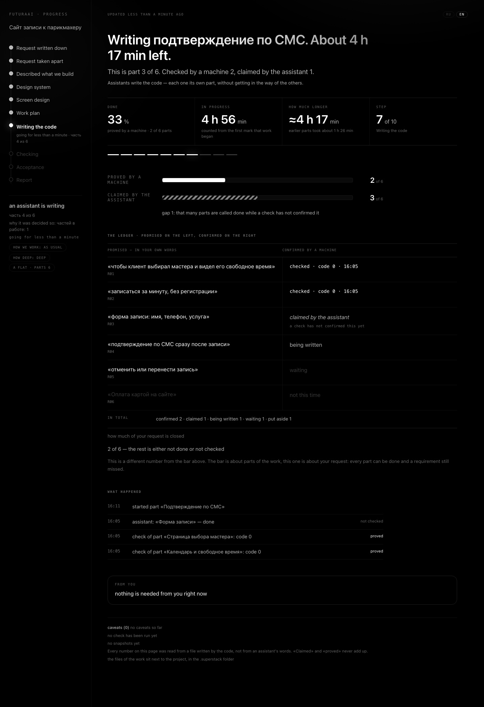

[🇷🇺 Русский](README.md) · 🇬🇧 English

# SUPERSTACK

**Say what you want built. Get a version whose "done" was closed by an exit code, not by a sentence in the chat.**

<p align="center"></p>

[](.claude-plugin/marketplace.json)
[](tests)
[](tests/mutations.json)
[](#requirements-and-platforms)
[](#under-the-hood)
[](LICENSE)
[](#quick-start)

2000 tests · 577 mutations, all caught · 353 mechanisms.

## What this is

SUPERSTACK is a plugin for Claude Code. You describe a product in your own
words — *"I want a site where people book a haircut"* — and it carries the job
all the way to a version that was actually checked. The rule the whole thing is
built around is short: **a report is a claim, not a proof.** "Should work" and
"tests should pass" mean the work is not done.

Here is what that looks like for the haircut site. It writes your sentence down
verbatim, then asks only the handful of questions you alone can answer — who
books, what happens on a double booking, what the client sees afterwards — and
measures everything else itself. It turns the answers into a requirements list
and a spec, designs the interface on a canvas and pulls the real values into the
code instead of retelling them, and shows you a plan. **You approve the plan
before a single line of code exists.** Then the tasks go out to a builder agent,
one fresh context per task, and the result is put in front of commands whose
exit code decides whether the turn may close.

Before it says "done", a separate agent reads only your original sentence and
the diff — no spec, no plan, no conversation — and answers one question: is this
what was asked for? What you get at the end is a report with a **How to open it**
section. An address, not a status.

It also knows how to look at your Claude Code setup, explain where every finding
came from, and change nothing without asking.

## Why

**An exit code closes the turn, not a sentence.** The end-of-session check in
`hooks/verify-gate.py` runs the project's own commands; while they return
non-zero the turn stays open, and no wording in the chat can close it.

**Blind acceptance before the word "done".** A separate agent
(`agents/blind-acceptance.md`) is handed your original request and the diff and
nothing else, so it grades what was asked for instead of agreeing with the plan
it just read.

**Snapshots at every stage boundary, so "put it back" is one sentence.**
`tools/checkpoint.py` snapshots the product folder before and after every edit;
`/oops` shows you what would come back before it returns anything. Nothing in
this system is deleted — removals go to quarantine, and a backup is written
before the first change.

**Plain language enforced by code, not by good intentions.** Jargon is
impossible to proofread out of your own writing — to notice an opaque word you
have to stop understanding it. The product talks to you in Russian, and
`tools/plain_ru.py` keeps that word list as data, finds the jargon by machine,
and answers with an exit code.

**No dependencies at all.** Python 3 and the standard library — 72 tools, about
24,800 lines, zero third-party packages, nothing to install, nothing to audit
downstream.

**The plugin holds itself to the bar it sells.** Nine gates, and the harshest is
mutation: **577 registered mutations** break the code on purpose, and every one
of them must turn the suite red. A check that cannot fail is not a check.

## Quick start

### Without opening a terminal

The plugin only works in Claude Code. Paste this text to your Claude Code and it
will do the rest itself:

```
Install SUPERSTACK for me. Run exactly these three commands in the terminal, one
at a time, and do not stop if the first one comes back red:

CLAUDECODE= claude plugin marketplace add edvardgrishin27/superstack-plugin
CLAUDECODE= claude plugin marketplace update superstack
CLAUDECODE= claude plugin install superstack@superstack

On a machine where SUPERSTACK was installed before, the first command answers
"Marketplace 'superstack' is already installed" and exits with code 1. That is
NOT a failed install and not a reason to stop: the marketplace is simply already
there. Keep going.

The second command is the one this whole text was rewritten for. Without it, such
a machine takes the OLD package list from its cache and installs the previous
version. It looks successful: green command, plugin installed, wrong version. On
a clean machine it is harmless, which is why it always runs.

The CLAUDECODE= prefix is required: without it `claude` refuses to start from
inside a session ("cannot be launched inside another Claude Code session"), and
that is not a bug — it is the guard against nested sessions.

Install nothing else. When you are finished, say in one line that it is done, and
tell the person to restart the whole application — not a new chat in the same
window: quit it completely (Cmd+Q on a Mac) and open it again. Plugins are read
at startup.
```

Verified by running it, not reasoned about: both sequences were executed against
an isolated config (`CLAUDE_CONFIG_DIR`), on a clean machine and again on top of
an existing install. Both ended on a working version.

### From a terminal

```bash
claude plugin marketplace add edvardgrishin27/superstack-plugin
claude plugin marketplace update superstack
claude plugin install superstack@superstack
```

No prefix needed here — you are already outside a session. On a machine that
already has the marketplace, the first line exits with code 1; that is fine, the
second line fixes it.

Then quit Claude Code completely (Cmd+Q on a Mac) and open it again. After that
you can just talk to it — there are no magic words to memorise.

## Commands

Seven commands. You never have to type them: each one also answers to ordinary
language, which is what the middle column is for.

| Command | Say it like this | What you get | What it does **not** do |
|---|---|---|---|
| `/go` | "I want a site for booking haircuts", "build me a bot that…" | A new product, or a large new part of one, from your sentence to a proved version: requirements list → spec → design on a canvas → a plan **you** approve → tasks built by agents → verification by exit code → a security pass → blind acceptance → project memory → a report with "How to open it" | Writes no code before you approve the plan; never calls the work done while the check returns non-zero; never drops a requirement on its own |
| `/change` | "fix the button", "change that text", "add a field" | One small edit to something that already works: snapshot before, the edit written by the builder agent, verification, snapshot after — so "changed the colour" and "broke the order form" cannot look alike in the chat | Not for building something large — that is `/go`; does not edit product files by hand, and does not fix unrelated things along the way |
| `/what` | "where was I", "what's next" | Exactly one line of state and exactly one next step, read from the tools rather than from the conversation | Not a menu, not a report; will not lift a pause on your behalf |
| `/stop` | "stop", "turn superstack off" — and back: "switch it on" | Everything pauses on your word alone, with no terminal, and the same way it comes back. The brake holds even when the agent stops responding, because it is a file on disk | Does not argue, does not talk you out of it, does not pause on its own initiative |
| `/oops` | "undo that", "put it back the way it was" | Two different things it never mixes up: the Claude Code settings this system changed, and your project folder returned to a snapshot from the build. It shows what will come back and rolls back only after you say yes | Does not return anything the system never touched; does not restore a secret — a backup keeps the file, never the password value |
| `/fix` | "not working", "nothing happens", "error again" | The links of the system itself, checked in order and stopping at the first broken one: is Python there, are the plugin files in place, does an automatic check point at a file that is gone, is everything paused, can the system write to its own folder. You get one broken link and one action | Does not look at your product and does not fix it — this is about the system, not about what you built. No menus, no stack traces |
| `/superstack` | "check my setup", "what do I have installed", "why is the agent behaving like this" | A profile of this machine and a repair pass: probes read configs, count skills and automatic checks, look at memory and connectors; the verdict opens as a page where every finding carries its origin — measured · inferred · ambiguous | Deletes nothing (quarantine instead, backup before the first change); applies no blocking finding without an explicit yes; prints no number a probe did not return |

## How it works

`/go` runs in phases, and the code is written in the second-to-last one. Every
phase before it establishes **what** to build; every phase after it proves that
**this** is what got built.


Skipping a phase is allowed; skipping it silently is not. When the design phase
or the security phase does not apply, it says so in one line — because "we
decided it wasn't needed" and "we forgot" look identical otherwise.


<p align="center"></p>

The progress panel: the headline number counts only what a machine proved; "the
assistant says so" is shown separately and is never added to it. This is a
screenshot of the real page on a demo state, not a mock-up.

## Under the hood

Python 3 and the standard library. Nothing else. 72 tools (about 24,800 lines),
7 skills, 3 agents, and three automatic checks wired into the session: one at
start-up, one before the context is compacted, one at the end of a turn.

The mechanisms worth naming, each of them a file you can open:

| Mechanism | Where it lives | What it buys |
|---|---|---|
| Verification closes the turn | `hooks/verify-gate.py`, `tools/verify.py` | "Done" is an exit code of zero; anything else keeps the turn open |
| Blind acceptance | `agents/blind-acceptance.md`, `tools/blind_accept.py` | Judgement made from the original request and the diff, with no plan to agree with |
| Snapshots and rollback | `tools/checkpoint.py`, `tools/oops.py` | Every stage boundary is a restore point; "put it back" is one sentence |
| Plain-language check | `tools/plain_ru.py` | Jargon in text meant for a human is found by code, not by proofreading |
| Live progress panel | `tools/live_panel.py`, `tools/progress.py` | A page on `localhost:8787` with an honest "how much is left" |
| Hand-off notice | `tools/notify.py` | You are told when the turn came back to you, instead of watching a chat |
| Builder wave watchdog | `tools/watchdog.py`, `tools/stall.py` | A stalled agent is noticed by the system rather than by you |
| Design pulled, not retold | `tools/design_pull.py` | Canvas values land in the code as values; contrast below 4.5:1 is refused |
| Security pass | `tools/security_pack.py`, `tools/data_rollback.py` | For products that face people; a data rollback path is named in commands or it does not count as ready |
| Builder contracts | `tools/contract.py` | "DONE" reported over a red suite is caught by code, not by reading |
| The pause file | `tools/pause.py`, `~/.claude/superstack/PAUSE` | An emergency brake that holds even when the agent will not answer |
| Nothing is deleted | `tools/apply.py`, quarantine + backups | Every change is reversible, and secrets are never copied — not even into a backup |

### The bar the plugin holds itself to

Nine gates, run by `tools/gauntlet.py`. Numbers below are measured, not typed in.

| Gate | What it proves |
|---|---|
| suite | the whole test suite green |
| hermetic | the same suite, still green, under any `HOME` |
| mutations | every registered breakage must turn the suite red |
| wiring | every tool reachable from a skill or an automatic check — built but unreachable is a real failure mode here |
| rules | the rule files are intact |
| manifest | marketplace entries match the tree, versions agree, schemas valid |
| plan | every mechanism in the map is present, and most of them are proved by an actual breakage |
| reconciliation | the map was read against the plan, and the plan has not changed since |
| skill weight | every skill stays under the size ceiling |

The counts at the top of this page — badges and summary line — are rewritten by
measurement at release time (`tools/sync_public.py`), in both language versions.
A showcase for a product that promises never to claim the unmeasured does not
get to type its own figures.

## How it differs from the sets next to it

Two other sets for Claude Code sit next to this one, and "how are they
different" is asked before install. Cells about SUPERSTACK name a file you can
open. Cells about the others carry only what was verified by reading their code
and docs on 3 September 2026; where verification was not possible it says "not
checked" — which is not the same as "no".

| What is compared | SUPERSTACK | Superpowers | Skills Matt Pocock |
| --- | --- | --- | --- |
| Who decides "done" | **an exit code**: non-zero keeps the turn open (`hooks/verify-gate.py`) | the model, by written rules | the model, by written rules |
| Breakages that must turn the suite red | **yes**, 576 registered (`tests/mutations.json`) | no | no |
| Tests of the tool itself | **yes**, suite green under any `HOME` (`tools/gauntlet.py`) | 44 files | not found |
| Blind acceptance | **yes**: the reviewer gets only the request and the diff (`tools/blind_accept.py`) | no, the spec is handed over | no, the spec is handed over |
| Numbers on the panel | **from files**; "claimed" shown apart and never added up (`tools/progress.py`) | no panel | no panel |
| "Put it back" | **yes**, one sentence, a snapshot at every stage (`tools/checkpoint.py`) | a branch, no command | no |
| Stop with one word | **yes**, a file that holds even when the agent is silent (`tools/pause.py`) | no | no |
| Your list of requirements | **yes**, verbatim and numbered; dropping needs your quote, checked by code (`tools/manifest.py`) | plan tasks, not requirements | numbered tickets |
| See where the work is | **yes**: a page-file with a snapshot, no server, RU/EN, on a phone (`tools/live_panel.py`) | a log and a to-do list | an issue tracker |
| Task size | **yes**: waves and tier computed by code (`tools/crew.py`) | yes | yes |
| How it starts | a plugin once, then seven commands and ordinary words | a plugin, skills fire by themselves | a plugin or files |

## What SUPERSTACK never does

Every line below is not a promise but a place in the code where it is locked.

- **Never calls the work done while the check returns non-zero.** The turn stays
  open until the code is zero — `hooks/verify-gate.py`, `tools/verify.py`.
- **Never writes code before you approve the plan.** The work phase does not
  open earlier — `tools/gates.py`, `skills/go/phases/3-план.md`.
- **Never drops one of your requirements on its own.** A drop needs your own
  words, and code checks they are in the original request — `tools/manifest.py`.
- **Deletes nothing.** Quarantine instead of deletion, a copy before the first
  edit — `tools/apply.py`.
- **Never copies your keys.** A backup keeps the file but not the password
  value, and the value never reaches the log — `tools/apply.py`, `tools/log.py`.
- **Never continues after "stop".** The brake is a file on disk, and it holds
  even when the agent will not answer — `tools/pause.py`.
- **Never runs destructive commands.** The list of dangerous ones is single for
  the whole set, and a separate layer enforces it rather than the model's
  memory — `tools/deny_list.py`.
- **Never prints a number it did not measure.** The progress page counts from
  files, and the figures on this page are rewritten at release time —
  `tools/progress.py`, `tools/sync_public.py`.

## Requirements and platforms

- **Claude Code**, desktop app or terminal. The plugin runs nowhere else —
  `claude plugin …` exists only here.
- **Python 3.8 or newer**, whatever the system already has. The floor comes from
  the syntax in the code: assignment expressions (`:=`) are used, nothing newer
  is. No third-party packages, at any version.
- **pytest**, only if you want to run the test suite.
- **macOS and Linux** — run live, end to end.
- **Windows** — the code paths are there (file locking falls back to `msvcrt`
  where `fcntl` is absent; the process-alive probe knows `os.kill` behaves
  differently), but **no live run has ever been done**. That is a status, not a
  disclaimer: `tools/platform_check.py` says it out loud at the start of a
  session and names what stops working — self-launch where the interpreter is
  not called `python3`, non-ASCII output in the Windows console, and the
  one-line `.sh` wrappers next to the tools.

## Status

Version 0.11.0. All nine gates green on the tree this text ships from.

Known **not** done, and said here rather than discovered later:

- Windows has never been run live. See above.

## Contributing

The rule for anything new is fixed, and it runs in this order:

> **mechanism → map → test → mutation → code.**

A mechanism is finished when it exists in `data/plan-coverage.json` with an
evidence file and a literal substring of executable text, has a test in `tests/`,
and has a registered breakage in `tests/mutations.json` that actually turns the
suite red. A mechanism nothing can break is not a mechanism.

```bash
python3 -m pytest tests/ -q          # the suite
python3 tools/gauntlet.py --quick    # fast loop: skips mutations and hermetic
python3 tools/gauntlet.py            # everything, roughly two hours
```

`--quick` exits with code 2 by design — two gates are not run in it, and
"skipped" is deliberately not "passed".

## License

MIT — see [LICENSE](LICENSE).

<details>
<summary>If you installed before version 0.3.0</summary>

Up to version 0.3.0 the system shipped as seven packages (`superstack-core`,
`-install`, `-spec`, `-guard`, `-build`, `-brain`, `-control`). There is one
package now, and the old seven have to be removed — otherwise two copies of the
same skills sit side by side and either of them can be picked up by description.

In the desktop app: **settings → plugins**, remove each of the seven old ones,
then **update** the `superstack` marketplace and install `superstack`. The order
matters twice. While the old ones are still there, two copies of the same skills
sit side by side. And without updating the marketplace, the old cached list is
used — the one with seven packages — and the previous version gets installed,
looking no different from the new one.

Why the split is gone. Seven packages would have made sense if they were
installed and updated separately. Neither ever happened once: the whole set went
in together and was updated together, seven identical actions in a row. The price
was cross-package addressing — a skill in one package calling a tool in another
through a path that does not exist inside its own package. That is how 14 tools
out of 29 once became unreachable, and how both calls in the only build skill
pointed at nothing for several runs. One package removes that whole class of
failure instead of patching it with another check.

**The `/plugin` slash command will not help.** It exists only in terminal Claude
Code; the desktop app does not have it, and trying it there answers "isn't
available in this environment". Verified on the desktop, not inferred.

</details>
