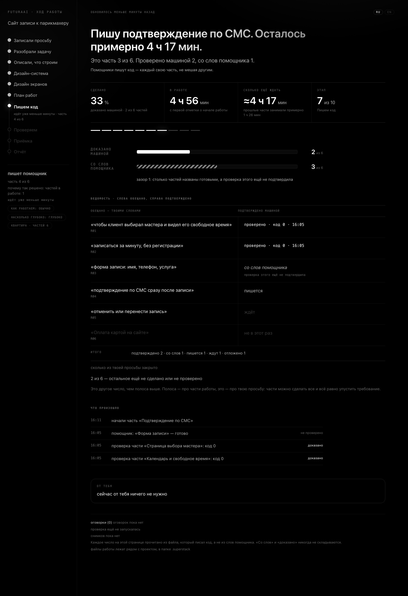

🇷🇺 Русский · [🇬🇧 English](README.en.md)

# SUPERSTACK

**Опиши продукт своими словами. Получи версию, которую проверили до того, как назвали готовой.**

<p align="center"></p>

[](.claude-plugin/marketplace.json)
[](tests)
[](tests/mutations.json)
[](#требования-и-платформы)
[](#что-под-капотом)
[](LICENSE)
[](#быстрый-старт)

2538 тестов · 724 мутаций, все ловятся · 492 механизмов.

Это числа проекта. Тесты проверяют код. Мутация ломает код нарочно, и набор
тестов обязан это заметить. Механизм это отдельная проверяемая часть плагина.

## Что ты получаешь

SUPERSTACK это плагин для Claude Code. Ты пишешь одну фразу, например
*«хочу сайт, где можно записаться к парикмахеру»*, и получаешь работающую
версию. В конце приходит отчет с разделом **«Как открыть»**. В нем адрес, а не
статус.

Между фразой и адресом плагин делает шесть шагов.

1. Записывает твою фразу дословно и спрашивает только то, что знаешь ты один.
   Кто записывается, что делать при двойной записи, что клиент видит после.
2. Превращает ответы в список требований и описание того, как продукт должен
   работать. Рисует интерфейс на холсте и переносит цвета и размеры в код
   точными значениями.
3. Показывает план. Первая строка кода появится после твоего «да».
4. Отдает задачи программирующему агенту по одной. Каждую он делает с чистого
   листа, без хвоста прежних разговоров.
5. Запускает проверки самого проекта. Пока они не прошли, работа не считается
   законченной.
6. Просит отдельного агента прочитать только твою исходную просьбу и сделанные
   изменения. Он отвечает на один вопрос. Сделали ли то, о чем просили.

Команда `/superstack` отдельно проверяет, как настроен твой Claude Code, и
ничего не меняет без твоего согласия.

## Быстрый старт

### Не открывая терминал

Плагин работает только в Claude Code. Вставь этот текст своему Claude Code, он
сделает все сам.

```
Поставь мне SUPERSTACK. Выполни в терминале ровно эти три команды, по одной,
и не останавливайся, если первая покраснеет:

CLAUDECODE= claude plugin marketplace add edvardgrishin27/superstack-plugin
CLAUDECODE= claude plugin marketplace update superstack
CLAUDECODE= claude plugin install superstack@superstack

Если первая команда ответит «Marketplace 'superstack' is already installed»,
это не ошибка, иди дальше. Вторую команду выполняй всегда, она обновляет
список пакетов. Префикс CLAUDECODE= обязателен. Больше ничего не устанавливай.
Когда закончишь, напиши одной строкой, что готово, и скажи человеку полностью
закрыть приложение (Cmd+Q на Mac) и открыть заново. Новый чат в том же окне не
подойдет, плагины читаются при старте.
```

Проверено на чистом компьютере и поверх прежней установки.

<details id="vnutri-teksta">
<summary>Что внутри этого текста</summary>

Первая команда добавляет каталог плагинов. Если он уже добавлен, команда
завершается с кодом 1, и это нормально. Вторая команда обновляет список
пакетов. Без нее на компьютере с прежней установкой берется старый список из
кэша, и ставится прежняя версия, хотя все выглядит успешно. Префикс
`CLAUDECODE=` нужен, потому что `claude` не запускается изнутри другой сессии.
Обе последовательности прогнаны на изолированном конфиге (`CLAUDE_CONFIG_DIR`).

</details>

### Из терминала

```bash
claude plugin marketplace add edvardgrishin27/superstack-plugin
claude plugin marketplace update superstack
claude plugin install superstack@superstack
```

Префикс здесь не нужен, ты уже вне сессии. Если каталог уже добавлен, первая
строка вернет код 1. Это нормально, вторая все поправит.

Закрой Claude Code целиком (Cmd+Q на Mac) и открой заново. Дальше пиши, что
нужно, обычными словами, специальные слова знать не надо. Подсказка, с чего
начать, приходит вместе с ответом на твою первую фразу.

## Почему этому можно верить

**Ход закрывает код возврата.** Проверка в конце хода (`hooks/verify-gate.py`)
запускает команды самого проекта. Пока они возвращают не ноль, ход открыт, и
формулировка в чате этого не меняет. Если ход закрыт без новой проверки, проверка сама говорит об этом
вслух, один раз за сеанс.

**«Доказано» ставит запись прогона.** Проверка оставляет запись с кодом
возврата, числом тестов, временем и отпечатком проекта. Нет свежей зеленой записи
с тем же отпечатком, и в отчете стоит «со слов».

**Приемка вслепую.** Агент из `agents/blind-acceptance.md` получает твою
исходную просьбу и изменения, без описания и плана. Он сверяет результат с
просьбой, и согласиться с планом ему не с чем.

**«Верни как было» одной фразой.** `tools/checkpoint.py` снимает папку продукта
до правки и после. `/oops` возвращает состояние до правки и сначала показывает,
что именно вернется. Настройки Claude Code не удаляются. Удаляемое уходит в
карантин, а копия пишется до первой правки.

**Ответы пишутся без жаргона.** Список запретных слов лежит в
`tools/plain_ru.py`, и текст с таким словом проверку не проходит.

**Планка у самого плагина.** Девять ворот гоняет `tools/gauntlet.py`. Самые
строгие мутационные. Каждая из **724 зарегистрированных поломок** ломает код
нарочно и обязана уронить набор тестов. Проверка, которая не может покраснеть,
проверкой не считается.

**Ни одной внешней зависимости.** Python 3 и стандартная библиотека. Ставить
нечего, проверять на стороне нечего.

## Команды

Их семь. Печатать их не обязательно, каждая отзывается и на обычные слова.

| Команда | Как позвать словами | Что делает |
|---|---|---|
| `/go` | «хочу сайт для записи к парикмахеру», «сделай бота, который…» | Ведет новый продукт или крупную часть от фразы до проверенной версии. Список требований, спека, дизайн на холсте, план с твоим «да», работа исполнителей, проверка кодом возврата, безопасность, приемка вслепую, память проекта, отчет «Как открыть» |
| `/change` | «поправь кнопку», «измени текст», «добавь поле» | Одна малая правка того, что уже работает. Снимок до, правка исполнителем, проверка, снимок после. Если снимок не вышел, спрашивает «вернуть будет нельзя, продолжать?» и ждет «да» |
| `/what` | «где я», «что дальше», «на чем я остановился» | Одна строка состояния и один следующий шаг, которые инструмент читает из файлов проекта |
| `/stop` | «останови», «выключи суперстек», а обратно «включи» | Пауза с одной фразы, без команд в терминале. Пока файл-тормоз лежит, новые шаги не начнутся. Идущую работу он не прерывает |
| `/oops` | «отмени», «верни как было» | Возвращает папку проекта к состоянию до правки или настройки Claude Code, которые система меняла сама. Сначала показывает, что вернется, и откатывает после согласия. Если возвращать нечего, отвечает «возвращать некуда» |
| `/fix` | «не работает», «ничего не происходит», «опять ошибка» | Проверяет звенья самой системы по порядку и останавливается на первом разорванном. Есть ли Python, на месте ли файлы плагина, включены ли проверки в этой папке, не стоит ли пауза, пишется ли папка состояния. Отвечает одним звеном и одним действием |
| `/superstack` | «проверь мою установку», «что у меня стоит», «почему агент так себя ведет» | Профиль машины. Пробы читают настройки, считают скиллы и проверки, смотрят память и подключения. Вердикт открывается страницей, где у каждой находки есть происхождение, измерено, выведено или неоднозначно |

## Как это устроено

`/go` идет фазами. Код пишется в четвертой. Все фазы до нее выясняют, **что**
строить, все после нее доказывают, что построили **именно это**.

```mermaid
flowchart LR
    A["Твоя фраза"]
    B["0 Завести"]
    C["1 Понять · G1"]
    D["2 Спека · G2"]
    E["2.5 Дизайн"]
    F["3 План · G3, ты подтверждаешь"]
    G["4 Работа"]
    H["5 Проверка · код ≠ 0 держит ход"]
    I["5.4 Безопасность"]
    J["5.5 Глазами"]
    K["6 Приемка вслепую · G4"]
    L["7 Память проекта"]
    M["8 Отчет · «Как открыть»"]
    A --> B --> C --> D --> E --> F --> G --> H --> I --> J --> K --> L --> M
```



Фазу можно пропустить, но молча нельзя. Когда дизайн или безопасность не
нужны, это говорится одной строкой.

<p align="center"></p>

Панель хода показывает главным числом только то, что проверила машина. Число
«со слов помощника» стоит отдельно и никогда с ним не складывается. Это снимок
настоящей страницы на показательном состоянии.

## Что под капотом

Python 3 и стандартная библиотека. 7 скиллов, 3 агента и три автоматические
проверки в сеансе. Они срабатывают на старте, перед сжатием контекста и в конце
хода. Каждый механизм лежит в файле, который можно открыть.

| Механизм | Где лежит | Что делает |
|---|---|---|
| Проверка закрывает ход | `hooks/verify-gate.py`, `tools/verify.py` | «Готово» это код возврата ноль, все остальное держит ход открытым |
| Приемка вслепую | `agents/blind-acceptance.md`, `tools/blind_accept.py` | Вердикт по исходной просьбе и изменениям, без плана |
| Снимки и откат | `tools/checkpoint.py`, `tools/oops.py` | Каждая граница этапа это точка возврата |
| Словарь простого русского | `tools/plain_ru.py` | Жаргон в тексте для человека ловит код |
| Панель хода | `tools/live_panel.py`, `tools/progress.py` | Страница на `localhost:8787` с оценкой, сколько еще осталось |
| Уведомление о ходе | `tools/notify.py` | Тебе скажут, когда ход вернулся к тебе |
| Сторож исполнителей | `tools/watchdog.py`, `tools/stall.py` | Замерший агент замечается системой |
| Дизайн значениями | `tools/design_pull.py` | Значения с холста идут в код как есть, контраст ниже `4.5:1` получает отказ |
| Пакет безопасности | `tools/security_pack.py`, `tools/data_rollback.py` | Для продуктов, которые выходят к людям. Путь отката данных объявлен командами |
| Контракты исполнителей | `tools/contract.py` | «Готово» при красных тестах ловится кодом |
| Файл-тормоз | `tools/pause.py`, `~/.claude/superstack/PAUSE` | Новые шаги не начнутся, пока файл лежит |
| Настройки не удаляются | `tools/apply.py` | Правка обратима, секреты не копируются даже в копию |

### Планка, которую плагин держит на себе

Девять ворот, их гоняет `tools/gauntlet.py`. Числа вверху страницы измерены.
Их переписывает выкладка (`tools/sync_public.py`) в обеих
языковых версиях.

| Ворота | Что доказывают |
|---|---|
| **набор** | весь набор тестов зеленый |
| **герметичность** | тот же набор зеленый при любом `HOME` |
| **мутации** | 724 зарегистрированных поломок, каждая обязана уронить набор |
| **проводка** | каждый инструмент достижим из скилла или автоматической проверки |
| **правила** | файлы правил целы |
| **манифест** | записи маркетплейса сходятся с деревом, версии совпадают, схемы валидны |
| **план** | каждый механизм карты на месте, и большинство проверено настоящей поломкой |
| **сверка** | карту читали против плана, и план с тех пор не менялся |
| **вес** | каждый скилл укладывается в потолок размера |

## Сравнение с соседними наборами

Вопрос «чем отличаются» задают раньше установки. В ячейках про SUPERSTACK
указан файл, который можно открыть. Данные о соседях взяты из их кода и
описаний 3 сентября 2026 года. Что проверить не удалось, там так и записано.

| Что сравниваем | SUPERSTACK | Superpowers | Skills Matt Pocock |
| --- | --- | --- | --- |
| Кто решает «готово» | **код возврата**, не ноль значит ход не закрыт (`hooks/verify-gate.py`) | модель, по тексту правил | модель, по тексту правил |
| Поломки, обязанные ронять набор | **да**, 724 зарегистрированных (`tests/mutations.json`) | нет | нет |
| Тесты у самого инструмента | **да**, набор зеленый при любом `HOME` (`tools/gauntlet.py`) | 44 файла | не найдено |
| Приемка вслепую | **да**, проверяющему дают только просьбу и изменения (`tools/blind_accept.py`) | нет, спеку дают | нет, спеку дают |
| Числа на панели | **из файлов**, «со слов» отдельно (`tools/progress.py`) | панели нет | панели нет |
| «Верни как было» | **да**, одной фразой, снимок на каждом этапе (`tools/checkpoint.py`) | ветка, команды нет | нет |
| Стоп одним словом | **да** (`tools/pause.py`) | нет | нет |
| Твой список требований | **да**, дословно с номерами, снять можно только с твоей цитатой (`tools/manifest.py`) | задачи плана | задачи с номерами |
| Как запускается | плагин один раз, дальше семь команд и обычные слова | плагин, скиллы включаются сами | плагин или файлы |

## Чего SUPERSTACK не делает никогда

Здесь только то, что подтверждает файл. Что исполняет ведущий (главный агент
сеанса) по правилу работы, названо правилом.

- **Не закрывает ход, пока проверки красные.** Пока код возврата не ноль, ход
  открыт. Если ход закрыт без новой проверки, проверка называет это вслух
  (`hooks/verify-gate.py`, `tools/verify.py`).
- **Не пишет код без твоего «да» на план.** Это правило работы, его исполняет
  ведущий (`skills/go/phases/3-план.md`).
- **Не снимает твое требование без твоих слов.** Код проверяет, что они есть в
  исходной просьбе (`tools/manifest.py`).
- **Не удаляет настройки Claude Code.** Вместо удаления карантин, перед первой
  правкой копия (`tools/apply.py`). Папку продукта возвращает «верни как было».
- **Не копирует твои ключи.** Копия хранит файл без значения пароля, и в журнал
  оно не попадает (`tools/apply.py`, `tools/log.py`).
- **Не начинает новых шагов после «стоп».** Тормоз это файл на диске, и
  идущую работу он не прерывает (`tools/pause.py`).
- **Не включает список запрещенных команд без твоего согласия**
  (`tools/deny_list.py`).
- **Не показывает чисел, которых не измерил.** Числа панели считаются из файлов,
  числа этой страницы переписывает выкладка (`tools/progress.py`,
  `tools/sync_public.py`).

## Требования и платформы

- **Claude Code**, десктопное приложение или терминал. Команд `claude plugin …`
  нет в других местах.
- **Python 3.8 или новее**, тот, что уже есть в системе. Нижняя граница взята из
  синтаксиса кода, там есть присваивающие выражения (`:=`) и ничего новее.
  Сторонних пакетов нет.
- **pytest**, если хочешь прогнать набор тестов.
- **macOS и Linux** проверены от начала до конца.
- **Windows**. Код готов, живой прогон не делался ни разу.

## Статус

Версия 0.14.0. Планку из девяти ворот выкладка проверяет на том дереве, из
которого едет этот текст.

## Как участвовать

Порядок для всего нового один.

> **механизм → карта → тест → мутация → код.**

Механизм готов, когда он записан в `data/plan-coverage.json` с файлом-уликой и
буквальной подстрокой исполняемого текста, у него есть тест в `tests/` и есть
зарегистрированная поломка в `tests/mutations.json`, которая действительно
роняет набор.

```bash
python3 -m pytest tests/ -q          # набор
python3 tools/gauntlet.py --quick    # быстрая петля без мутаций и герметичности
python3 tools/gauntlet.py            # все целиком, примерно два часа
```

`--quick` возвращает код 2 намеренно. Двое ворот в нем не запускаются, а
«пропущено» и «пройдено» должны выглядеть по-разному.

## Лицензия

MIT, см. [LICENSE](LICENSE).

<details>
<summary>Если ставили до версии 0.3.0</summary>

До версии 0.3.0 система ставилась семью пакетами (`superstack-core`,
`-install`, `-spec`, `-guard`, `-build`, `-brain`, `-control`). Теперь пакет
один, и старые семь надо снять. Иначе рядом лягут две копии одних и тех же
скиллов.

В десктопном приложении открой **настройки → плагины**, у каждого из семи
старых нажми «удалить», затем у маркетплейса `superstack` нажми **обновить** и
поставь `superstack`. Порядок важен. Без обновления маркетплейса берется старый
список из кэша, где пакетов семь, и ставится прежняя версия, внешне неотличимая
от новой.

**Слэш-команда `/plugin` не подойдет.** Она есть только в терминальном Claude
Code. В десктопном приложении она отвечает «isn't available in this
environment». Проверено на десктопе.

</details>
